# Addax Admin

[](https://opensource.org/licenses/Apache-2.0)
[](https://openjdk.java.net/)
[](https://spring.io/projects/spring-boot)
[](https://vuejs.org/)

Addax Admin 是为 Addax ETL 引擎打造的一套现代化、企业级 ETL 管理与监控控制台。项目以 Monorepo 的形式组织，包含完整的后端 API 服务与前端管理界面，旨在提供从任务配置、调度执行、运行监控到日志审计的一站式运维体验。

核心目标：让数据工程师和运维人员更容易地管理 Addax 作业、观察运行状态、调优并发与重试策略，并在多节点部署下保证高可用与并发控制。

---

## 界面预览

以下为生产环境页面截图，帮助你快速了解界面与功能覆盖：

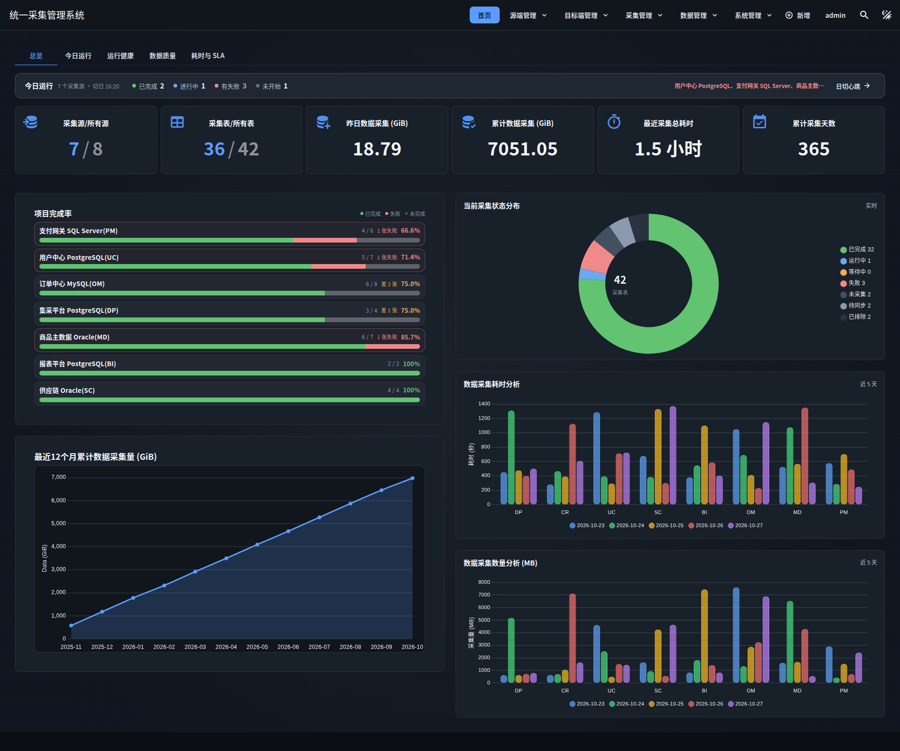
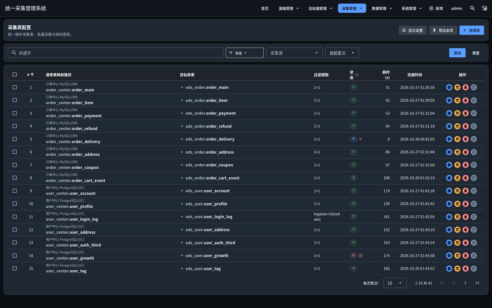
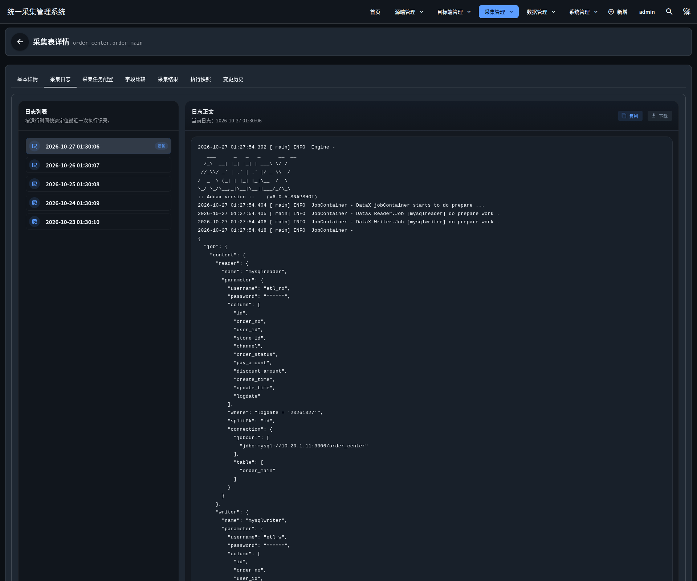
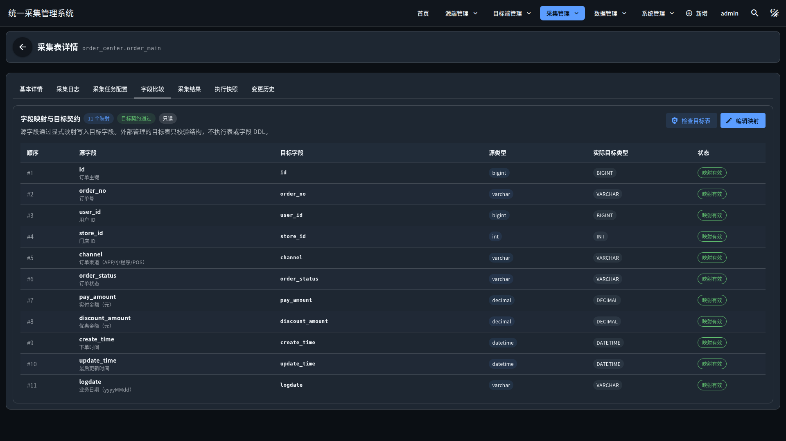
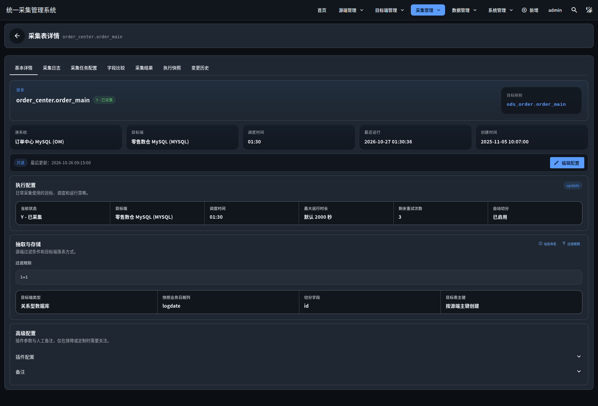
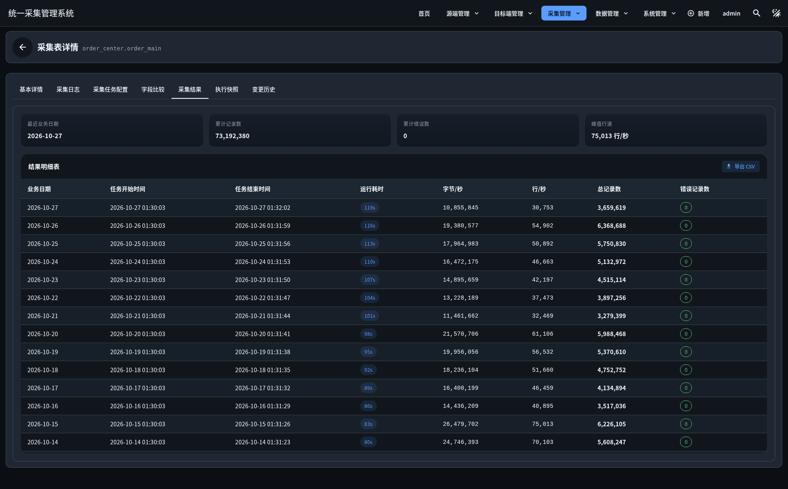
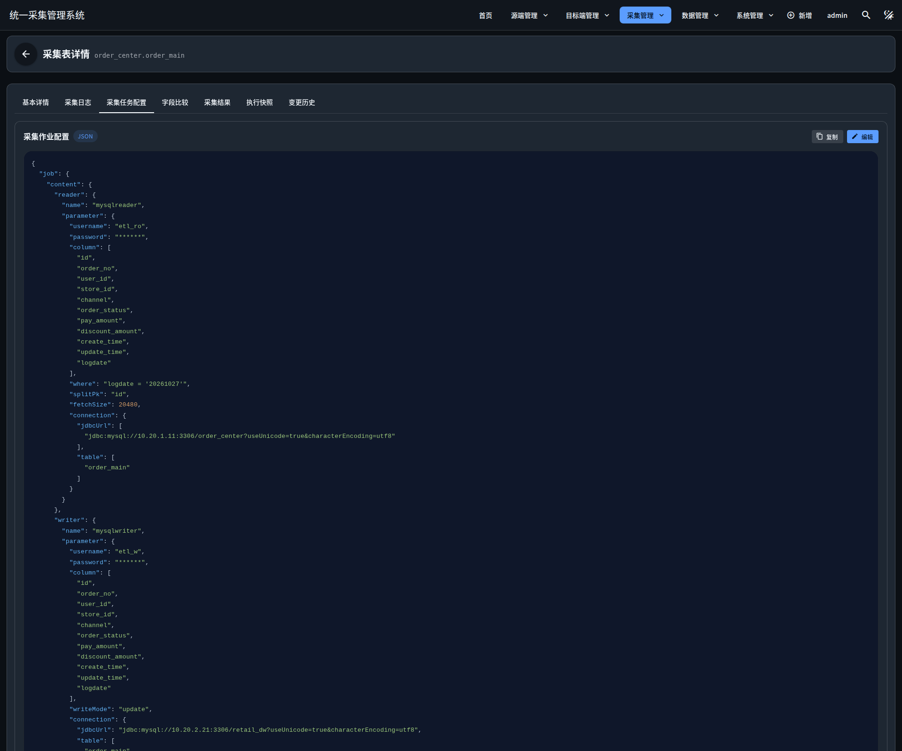
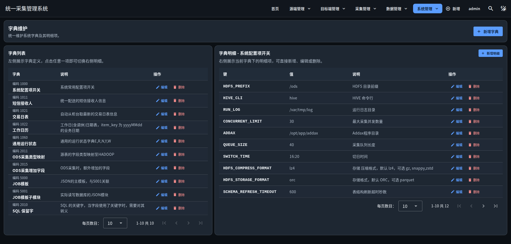
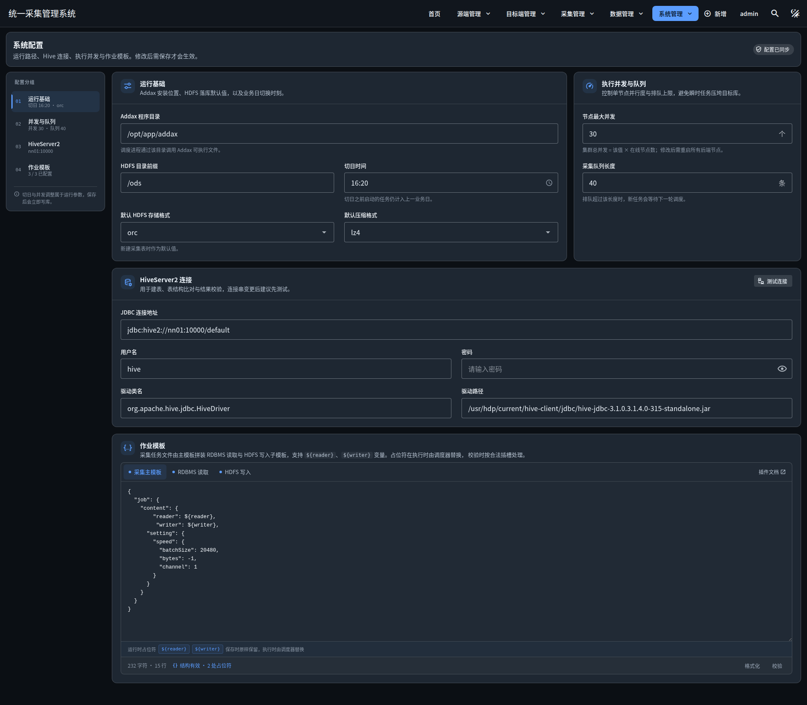

如果需要更多页面截图，可直接查看 [screenshots/](screenshots/)。

## 目录结构（简要）

```
addax-admin/
├── backend/                 # Spring Boot 3 后端服务（API、调度、持久化、Redis 仲裁）
├── frontend/                # Vue 3 + Vite + TypeScript + Vuetify 管理界面
├── scripts/                 # 部署与运维脚本（DB 初始化、systemd service 模板等）
└── README.md                # 本文档
```

## 主要组成

- Addax Admin Backend：Spring Boot 实现，负责任务持久化（Postgres）、分发逻辑、Redis 锁与仲裁、权限与 JWT、调度（cron/周期）等。
- Addax Admin Frontend：基于 Vue 3 + Vuetify 的单页应用，提供任务配置、ODS 表管理、日志查看、实时监控与告警配置。
- 数据库初始化：scripts/schema.sql 和 scripts/data.sql 提供数据库 schema 与默认数据。

---

## 亮点与特色

- 混合并发控制架构：DB 持久化队列 + Redis 仲裁（per-job 锁、全局/源级 permit），兼顾可靠性与性能。
- 快速批量创建采集表：在 UI 中只需点击几下即可批量新增数百到上千张采集表；并支持一键在目标端（Hive 或关系型数据库）中同步创建表与字段，显著提升大规模数据接入效率。
- 表结构演化支持：自动探测源端表结构变化（字段类型变更、新增/删除字段等），并可自动同步修改目标表结构；对有分区的表提供历史数据兼容策略，最大限度减少中断与人工干预。
- 外部目标表支持：目标表和字段可由 DBA 或外部治理流程创建，平台只读取实时元数据、确认字段映射并校验目标契约，不自动修复外部结构。
- 显式字段映射：源字段与目标字段可不同名，Reader、Writer、DDL、执行快照和错误提示使用同一份映射契约；不开放 SQL 表达式，保持 ODS 直接贴源。
- 动态表名采集：原生支持日表、月表等动态表名模板（例如 my_table_{yyyyMMdd}），自动解析时间规则并生成相应的采集任务，方便处理按时间切分的数据源。
- 增量采集与智能过滤：支持使用上一次采集结果（例如前一日最大 ID 或指定字段）作为本次增量采集的过滤条件；同时支持自定义过滤表达式，适合复杂增量场景。
- 多节点并发与权重：采用 sharing-nothing 架构与 Redis 仲裁，支持节点权重设定（node.concurrency.weight），实现全局/源级并发控制、任务高可用与负载均衡。
- 可视化管理：完整的任务配置、字段对比、实时执行进度与历史日志查询，提升运维效率。
- 企业级安全与可扩展性：JWT + Spring Security 做权限与认证，采用 Spring Data JPA 与模块化前端设计，方便定制与扩展。

---

## 目标表结构与字段映射

批量新增采集表采用五步流程：选择采集源、选择采集表、配置目标策略、逐表预览与校验、查看创建结果。一个批次共用一套目标端配置，但每张表都会独立返回目标结构、字段映射、告警和阻断原因。

### 目标表结构管理

| 模式 | 目标表要求 | 平台行为 |
| --- | --- | --- |
| `MANAGED`（平台管理） | 可以不存在，也可以已存在 | 创建或演进目标表、写入字段映射并初始化采集任务 |
| `EXTERNAL`（外部管理） | 创建采集定义前必须已存在 | 只读取目标元数据并校验契约，不创建或修改目标表、字段和约束 |

外部管理模式适用于目标表由 DBA 或外部治理流程统一维护的场景。预览阶段会显示目标表实际结构、源字段与目标字段的映射，以及类型、非空约束、主键和分区不兼容项。目标结构不兼容或表不存在时，该表不能提交。提交时会重新读取目标元数据；如果预览后目标结构发生变化，该表的创建会被阻断并要求重新预览，其他表仍可独立完成创建。

### 字段映射

- 映射是稳定的、一对一 `source -> target` 契约，源字段与目标字段允许不同名。
- Reader 输出别名、Writer 列、目标 DDL、执行快照和错误提示使用同一份映射，避免字段改名后链路不一致。
- 不开放 SQL 表达式，目标仍按 ODS 贴源层处理，不在本平台内引入额外转换风险。
- 未映射的目标必填字段、重复目标字段和目标表结构漂移会形成阻断项；可安全忽略的额外字段会产生告警。
- 字段映射 Tab 默认只读，点击“编辑映射”后才能修改；取消不会保存，保存后会重新生成采集任务。

批量预览会逐表隔离失败，允许排除阻断表后继续创建其余表。最终确认前会对纳入创建的表重新执行完整校验，避免把过期预览直接落库。实现决策详见 [ADR 0002](docs/adr/0002-external-target-contract-and-column-mapping.md)。

---

## 目标端支持

目标端由 `etl_target` 的路由键决定，同一套界面里可以混用：

| 目标端 | 模板键 | 已实现方言 | 说明 |
| --- | --- | --- | --- |
| Hive / HDFS | `wH` | Hive | 按业务日期分区写入，默认目标端 |
| 关系型数据库 | `wR` | MySQL、PostgreSQL、SQL Server | 直接写回业务库，按主键幂等写入 |

关系型数据库目标（阶段一）的语义与限制：

- 写入语义按主键幂等：建表时用源端主键生成 `PRIMARY KEY`；`overwrite` 在 MySQL 上映射为 `REPLACE INTO`，PostgreSQL / SQL Server 请显式配置 `update`（依赖主键或唯一键）。目标表没有主键/唯一键时会记录风险日志，因为重复执行会插入重复数据。
- 表结构演化：自动同步新增列与“容量变大”的类型变更（如 `int → bigint`、`varchar(20) → varchar(50)`）；变窄、类型族变更以及主键列的类型变更不会自动执行，只记录风险日志，需人工处理。
- 暂未支持的方言：Oracle、DB2、Sybase、ClickHouse、SQLite 在保存目标端或测试连接时会直接报错，不会生成引用不存在 writer 插件的采集任务。
- 已知限制：SQL Server 列注释不落地；跨方言的 `enum`/`set` 退化为字符串列；源端 `DEFAULT` 仅在类型演化时重述、建表时不复制；宽字符集下的宽主键（如 `utf8mb4 varchar(1000)`）可能超过 InnoDB 3072 字节索引上限。

### 目标端表属性（阶段二）

目标端专属属性不再钉死在 `etl_table` 上，而是按目标端族存放在 `etl_table.target_options`（jsonb）：

| 分组 | 属性 | 说明 |
| --- | --- | --- |
| `hdfs` | `partitionBindings` | 目标分区键与运行期取值的一对一绑定；支持业务日期或固定值，可配置多个分区键 |
| `hdfs` | `partitionCreationMode` | Hive 分区创建责任，`PLATFORM` 表示运行期由平台创建，`EXTERNAL` 表示由外部创建并在运行前校验 |
| `hdfs` | `storageFormat` / `compressFormat` | Hive/HDFS 文件存储与压缩格式；为空时沿用系统设置（`HDFS_STORAGE_FORMAT` / `HDFS_COMPRESS_FORMAT`） |
| `rdbms` | `businessDateColumn` | 平台提供的普通快照字段，为空表示不承载业务日期；不是数据库分区字段 |
| `rdbms` | `createPrimaryKey` | 是否按源端主键在目标表建主键，默认开 |

表详情与批量创建表单按目标端能力动态渲染：Hive 目标端显示分区/存储字段，关系型目标端显示快照日期列与主键开关。

- 快照式采集：配置 `businessDateColumn`（如 `logdate`）后，目标表会多出一列 `varchar(8)`（SQL Server 为 `nvarchar(8)`），采集时由 reader 注入当天的业务日期字面量。该列是普通快照字段，**不是分区键，也永远不参与主键**，目标主键只按源端主键生成。所以跨天采集时要配合以下任一种方式：关闭“创建主键”（同一业务主键在多天会互相覆盖），或用 `preSql` 先删除当日数据；两种情况下都会记录一条风险日志提醒。已存在的表只补加该列、不改动已有主键。源表若已有同名列则直接复用，不再重复注入。这类表也支持补数。
- 没有日期维度的表（HDFS 非分区表、未配置业务日期列的关系型目标表）不支持补数——补多个日期会互相覆盖，提交时会被跳过并记录风险日志。
- 主键开关：关闭 `createPrimaryKey` 后建表不再生成主键，重复执行的去重交给 `writeMode` / `preSql`；配置了快照日期列又关闭主键时会记录风险日志提醒。

升级说明：从 v4.2.0 升级时无需手工改表——服务启动会自动执行一次幂等迁移，把 `etl_table` 的
`part_kind`/`part_name`/`part_format`/`storage_format`/`compress_format` 回填进 `target_options`，
重建 `vw_etl_table_with_source` 视图，然后删除旧的 5 列。全新安装直接以 `scripts/schema.sql` 为准。

---

## 🚀 快速开始（5 分钟部署）

### 容器模式

#### 方式一：拉取预构建镜像（推荐，无需本地构建）

适用于快速体验与生产部署，不需要源码和构建工具链。

```bash
# 1. 创建部署目录
mkdir addax-admin && cd addax-admin
mkdir -p scripts

# 2. 下载部署文件（docker-compose.yml 和数据库初始化脚本）
wget https://raw.githubusercontent.com/wgzhao/addax-admin/master/docker-compose.yml
wget -P scripts/ https://raw.githubusercontent.com/wgzhao/addax-admin/master/scripts/schema.sql
wget -P scripts/ https://raw.githubusercontent.com/wgzhao/addax-admin/master/scripts/data.sql

# 3. 拉取镜像并启动（默认拉取 Docker Hub 上的 wgzhao/addax-admin:latest）
docker compose -f docker-compose.yml pull
docker compose -f docker-compose.yml up -d

# 4. 查看状态与日志
docker compose -f docker-compose.yml ps
docker compose -f docker-compose.yml logs -f
```

> 国内网络无法访问 Docker Hub 时（`registry-1.docker.io` 超时），请先为 Docker 配置
> 镜像加速器（见 [Docker 镜像加速配置](https://docs.docker.com/registry/recipes/mirror/)），
> 或改用 Quay 备用源：
> ```bash
> echo "DOCKER_REGISTRY=quay.io/wgzhao" >> .env
> docker compose -f docker-compose.yml pull
> docker compose -f docker-compose.yml up -d
> ```

#### 方式二：克隆源码本地构建

适用于二次开发或希望构建最新代码的场景。

```bash
git clone https://github.com/wgzhao/addax-admin.git
cd addax-admin
docker compose up -d --build
```

#### 访问应用

运行成功后，访问 <http://localhost:50080>，默认账号为 admin，密码为 `admin123`

更多详细配置请参考 [DOCKER.md](DOCKER.md)

### 本地开发模式

先决条件

- Java 21
- Maven 3.8+
- Node.js >= 16.x
- Yarn（或 npm）
- PostgreSQL（建议 15+）、Redis（用于任务仲裁）

一键启动（推荐）

```bash
# 克隆项目并进入目录
git clone https://github.com/wgzhao/addax-admin.git
cd addax-admin

# 一键启动前后端开发环境
./start-dev.sh
```

若选择手动启动：

后端（开发）

```bash
# 1. 初始化数据库（在 PostgreSQL 中创建数据库 addax_admin）
psql -U postgres -d your_database -f backend/src/main/resources/schema.sql
psql -U postgres -d your_database -f backend/src/main/resources/data.sql

# 2. 运行后端服务
cd backend
mvn spring-boot:run
```

前端（开发）

```bash
cd frontend
yarn install
yarn dev
```

默认访问地址（开发）

- 前端（Vite dev server）：<http://localhost:3030>
- 后端 API（Spring Boot）：<http://localhost:50601/api/v1>

生产构建与运行

后端打包并运行：

```bash
mvn clean package
java -jar backend/target/addax-admin-<version>.jar
```

前端构建并静态部署：

```bash
yarn build
```

建议在生产环境使用 docker + docker-compose 将 Postgres / Redis / 后端 / 前端（静态）组合部署。

---

配置（环境变量）

后端配置位于：backend/src/main/resources/application.properties
可以通过环境变量覆盖（示例：backend/config/env.template.sh）

重要环境变量（后端）：

- DB_HOST, DB_PORT, DB_NAME, DB_USERNAME, DB_PASSWORD
- REDIS_HOST, REDIS_PORT, REDIS_PASSWORD, REDIS_DB
- LOG_DIR（默认 ./logs）
- node.concurrency.weight（调度权重）
- WECOM_ROBOT_KEY（企业微信机器人，用于告警）

前端环境变量（vite）

- VITE_API_BASE_URL（如 /api 或 /api/v1）
- VITE_API_HOST（后端地址，例如 <http://localhost:50601）>

文档链接

- 功能详解（含批量创建、schema 变更、动态表、增量过滤、多节点并发等）：docs/FEATURES.md
- 示例与模板：docs/examples/

---

数据库与迁移

项目自带初始化脚本：

- scripts/schema.sql（表结构与索引）
- scripts/data.sql（初始数据）

如果你在生产环境部署，建议：

- 在单独的数据库实例创建专用用户与数据库
- 使用备份与版本化迁移工具（Flyway / Liquibase）管理 schema 变更

---

调度与并发控制机制概览

核心思路：保留数据库持久化语义（任务队列、审计、重试），用 Redis 做实时仲裁以避免数据库争用并支持低延迟并发限制。

- 每个任务在 DB 持久化为 etl_job_queue，节点领取任务时会获取 Redis per-job 独占锁以及 permit（全局或源级）。
- Redis 锁使用 SETNX + TTL 并通过 Lua 脚本释放以保证 token 匹配。
- 执行中节点会周期性续租锁与 permit，完成后释放资源并更新 DB 状态。

充分利用此机制可以在多实例部署下保证高可用与并发可控。

### 数据表采集流程图

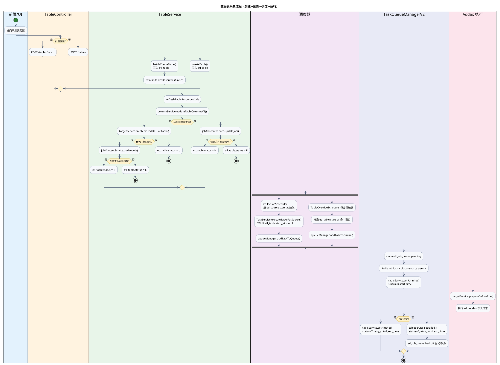

如果上图没有渲染，可以参考  查看高清版本。

---

日志与监控

- 默认日志目录：./logs（可通过 LOG_DIR 覆盖）
- 后端日志配置：backend/src/main/resources/logback-spring.xml
- 建议在生产通过日志聚合（ELK / Loki）和监控（Prometheus + Grafana）汇总指标与告警

---

常见故障排查

- 应用无法连接数据库：检查 DB_* 环境变量与 schema.sql 是否已应用
- Redis 连接失败：确认 spring.data.redis.* 环境变量与网络可达
- JWT 认证错误：检查后端 JwtService 配置（jwt.expiration、密钥等）
- 前端 API 跨域或代理异常：检查 VITE_API_BASE_URL 与 vite.config.ts 的 proxy 配置
- 端口冲突：默认前端 3030，后端 50601，请确认端口未被占用

---

开发者与贡献指南

欢迎贡献！建议流程：

1. Fork && 新建分支（feature/xxx 或 fix/xxx）
2. 本地开发并保证 lint / type check 通过
3. 提交并发起 Pull Request，描述变更理由和回归测试步骤

---

许可证

本项目基于 Apache License 2.0（详见 LICENSE 文件）。
