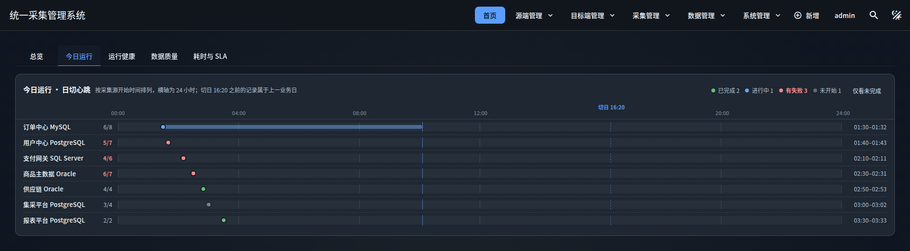
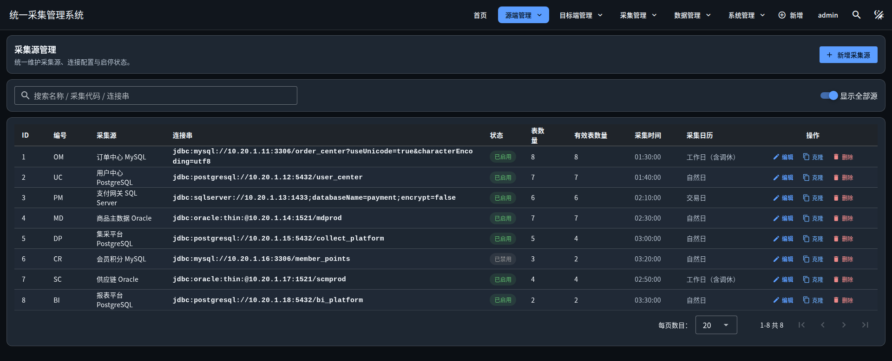
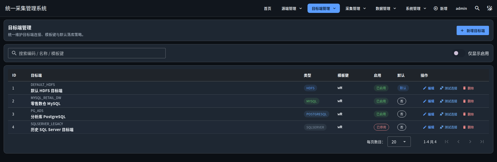
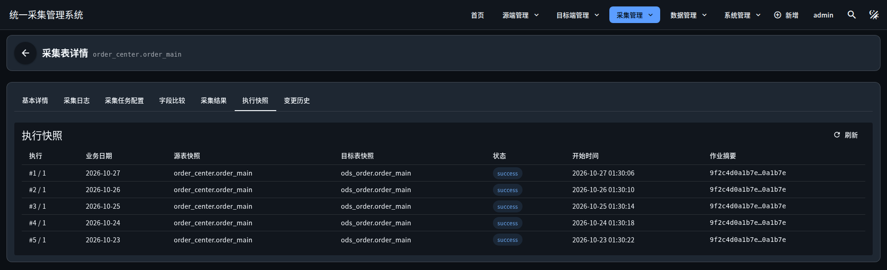
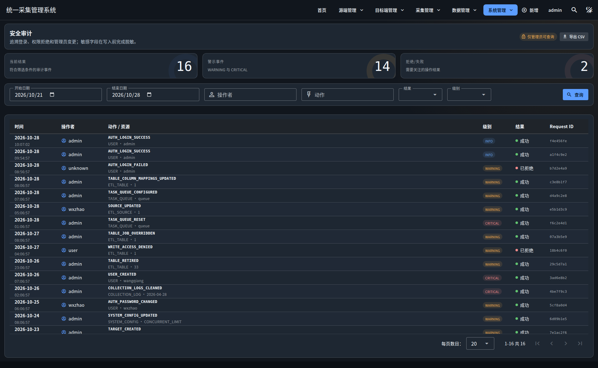

# Addax Admin

[](https://opensource.org/licenses/Apache-2.0)
[](https://openjdk.java.net/)
[](https://spring.io/projects/spring-boot)
[](https://vuejs.org/)

Addax Admin 是为 Addax ETL 引擎打造的一套现代化、企业级 ETL 管理与监控控制台。项目以 Monorepo 的形式组织，包含完整的后端 API 服务与前端管理界面，旨在提供从任务配置、调度执行、运行监控到日志审计的一站式运维体验。

核心目标：让数据工程师和运维人员更容易地管理 Addax 作业、观察运行状态、调优并发与重试策略，并在多节点部署下保证高可用与并发控制。

---

## 界面预览

以下为系统界面截图（演示数据），帮助你快速了解界面与功能覆盖：













如果需要更多页面截图，可直接查看 [screenshots/](screenshots/)。

## 目录结构（简要）

```text
addax-admin/
├── backend/                 # Spring Boot 3 后端服务（API、调度、持久化、队列与租约）
├── frontend/                # Vue 3 + Vite + TypeScript + Vuetify 管理界面
├── docs/                    # 安装与使用手册、ADR、测试与安全文档
├── scripts/                 # 部署与运维脚本（DB 初始化、systemd service 模板等）
└── README.md                # 本文档
```

## 主要组成

- Addax Admin Backend：Spring Boot 实现，负责任务持久化（PostgreSQL）、分发逻辑、数据库租约、Redis 选主与心跳、权限与 JWT、调度（cron/周期）等。
- Addax Admin Frontend：基于 Vue 3 + Vuetify 的单页应用，提供任务配置、ODS 表管理、日志查看、实时监控与告警配置。
- 数据库初始化：[scripts/schema.sql](scripts/schema.sql) 和 [scripts/data.sql](scripts/data.sql) 提供数据库 schema 与默认数据。

---

## 亮点与特色

- 混合并发控制架构：DB 持久化队列 + Redis 选主与任务分发 + 数据库租约，兼顾可靠性、审计能力与故障恢复。
- 快速批量创建采集表：在 UI 中只需点击几下即可批量新增数百到上千张采集表；并支持一键在目标端（Hive 或关系型数据库）中同步创建表与字段，显著提升大规模数据接入效率。
- 表结构演化支持：自动探测源端表结构变化（字段类型变更、新增/删除字段等），并可自动同步修改目标表结构；对有分区的表提供历史数据兼容策略，最大限度减少中断与人工干预。
- 目标契约与显式字段映射：目标表支持平台托管（自动建表与结构演进）和外部管理（只读校验、不执行 DDL）两种模式；源字段与目标字段允许不同名，Reader 输出、Writer 列、DDL、执行快照和错误提示共用同一份一对一映射；批量创建逐表预览并隔离阻断与告警。
- 动态表名采集：原生支持日表、月表等动态表名模板（如 `t_order_${biz_date_short}`），自动解析业务日期并生成相应的采集任务。
- 增量采集与智能过滤：支持使用上一次采集结果（例如前一日最大 ID 或指定字段）作为本次增量采集的过滤条件；同时支持自定义过滤表达式，适合复杂增量场景。
- 多节点并发与权重：采用 sharing-nothing 架构、Redis 选主与心跳、节点权重设定（`WEIGHT`），实现全局/源级并发控制、任务高可用与负载均衡。
- 可视化管理：完整的任务配置、字段对比、实时执行进度与历史日志查询，提升运维效率。
- 企业级安全与可扩展性：JWT + Spring Security 做权限与认证，采用 Spring Data JPA 与模块化前端设计，方便定制与扩展。

---

## 文档

- [安装与使用手册](docs/manual/README.md)
- [Docker 部署](docs/manual/install/01-docker.md)
- [主机模式与本地开发](docs/manual/install/02-source.md)
- [快速上手](docs/manual/usage/01-quick-start.md)
- [目标表结构与字段映射](docs/manual/usage/05-target-contract.md)
- [目标端能力与表属性](docs/manual/usage/06-target-engines.md)
- [调度与并发](docs/manual/usage/09-scheduling.md)
- [故障排查](docs/manual/operations/02-troubleshooting.md)
- [架构决策记录](docs/adr/)

---

## 🚀 快速开始

Addax Admin 支持两种部署模式：

- **Docker 模式**：适合快速体验和标准化部署，前后端、PostgreSQL、Redis 由 Docker Compose 管理。
- **主机模式**：适合已有 Java、PostgreSQL、Redis、Nginx 基础设施的环境，使用编译产物分别部署后端和前端。

两种模式都需要单独准备 **Addax 采集引擎**。Addax Admin 只负责管理和调度，不执行实际采集。

### Docker 模式（推荐）

#### 前置条件

- Docker 20.10+、Docker Compose 2.0+
- Addax 采集引擎，安装到应用容器可访问的目录

#### 方式一：拉取预构建镜像

```bash
# 1. 创建部署目录
mkdir addax-admin && cd addax-admin
mkdir -p scripts

# 2. 下载部署文件
wget https://raw.githubusercontent.com/wgzhao/addax-admin/master/docker-compose.yml
wget -P scripts/ https://raw.githubusercontent.com/wgzhao/addax-admin/master/scripts/schema.sql
wget -P scripts/ https://raw.githubusercontent.com/wgzhao/addax-admin/master/scripts/data.sql

# 3. 拉取镜像并启动（默认拉取 Docker Hub 上的 wgzhao/addax-admin:latest）
docker compose -f docker-compose.yml pull
docker compose -f docker-compose.yml up -d

# 4. 查看状态与日志
docker compose -f docker-compose.yml ps
docker compose -f docker-compose.yml logs -f
```

国内网络无法访问 Docker Hub 时，可以为 Docker 配置镜像加速器，或改用 Quay 备用源：

```bash
echo "DOCKER_REGISTRY=quay.io/wgzhao" >> .env
docker compose -f docker-compose.yml pull
docker compose -f docker-compose.yml up -d
```

#### 方式二：克隆源码本地构建

```bash
git clone https://github.com/wgzhao/addax-admin.git
cd addax-admin
docker compose up -d --build
```

#### 访问应用

运行成功后访问 <http://localhost:50080>，默认账号 `admin`，密码 `admin123`。首次登录后请立即修改密码。

### 主机模式（编译产物）

适用于不使用 Docker、已有 Java 21、Maven、Node.js、Yarn、PostgreSQL、Redis 和 Nginx 的环境。

```bash
# 1. 创建数据库和用户，然后初始化
psql -U postgres -c "CREATE USER addax_admin WITH PASSWORD 'addax_admin@123';"
psql -U postgres -c "CREATE DATABASE addax_admin OWNER addax_admin;"
psql -U addax_admin -d addax_admin -f scripts/schema.sql
psql -U addax_admin -d addax_admin -f scripts/data.sql

# 2. 构建后端与前端
cd backend && mvn clean package -DskipTests && cd ..
cd frontend && yarn install && yarn build && cd ..

# 3. 部署后端：lib/addax-admin-<version>.jar
#    bin/service.sh、config/、drivers/、job/、logs/
#    默认服务端口 50601

# 4. 部署前端：将 frontend/dist 交给 Nginx
#    并将 /api/v1 反向代理到 50601
```

后端目录布局、`config/env.sh`、systemd、Nginx 配置和升级步骤见 [主机模式与本地开发](docs/manual/install/02-source.md#主机模式部署)。

完整的 Addax 引擎安装、环境变量、源码构建、本地开发、升级迁移、备份恢复和故障排查见 [安装与使用手册](docs/manual/README.md)。

---

## 开发者与贡献指南

欢迎贡献！建议流程：

1. Fork 并新建分支（`feature/xxx` 或 `fix/xxx`）。
2. 本地开发并保证 lint、type check 和相关测试通过。
3. 提交并发起 Pull Request，描述变更理由和回归测试步骤。

---

## 许可证

本项目基于 Apache License 2.0（详见 [LICENSE](LICENSE) 文件）。
